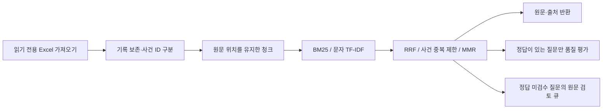

# 저작권 판례 RAG — 검색 근거와 평가의 분리

기존 수업의 Vector Search·청킹·MMR·Hybrid RAG 실험을 바탕으로, **유료 API 없이 재현 가능한 검색과 평가 도구**를 추가했습니다. 검색 결과의 다양성뿐 아니라 정답 판례의 순위, 원문 출처와 평가 레이블의 유무를 구분합니다.

이번 개선은 RAG의 검색·평가 단계입니다. 새 LLM 답변 생성기나 법률 상담 서비스를 만들지 않았습니다. 기존 노트북의 신경망 임베딩을 무료로 재현했다고 주장하지 않습니다.

## 바로 실행

Python 3.11 이상에서 외부 패키지·키·모델 다운로드 없이 실행합니다.

```bash
python -m unittest discover -s tests -v

python -m retrieval search \
  --corpus examples/cases.json \
  --question '온라인 게임 규칙과 화면 구성' \
  --output artifacts/demo-search.json

python -m retrieval evaluate \
  --corpus examples/cases.json \
  --questions examples/questions.json \
  --split test \
  --output artifacts/demo-test-v1
```

`examples/`는 **직접 작성한 가상의 기록·질문**입니다. 실제 판례 문구나 법률 정답 데이터가 아닙니다. 긴 글꼴 기록을 의도적으로 넣어 같은 사건이 여러 청크를 차지하는 상황도 검사합니다. 결과 경로가 이미 있으면 덮어쓰지 않으므로 재실행할 때 새 이름을 사용합니다.

출력은 `generated_answer=false`인 원문 검색 결과입니다. `record_id`, `case_id`, `chunk_id`, 원문 문자열과 Python 문자 위치 `[start:end]`를 함께 반환합니다. 헤더를 원문 위치로 혼동하지 않으며, 반환 전에 원문 슬라이스가 일치하는지 검사합니다. 문자 위치는 바이트 위치나 Excel 행 번호가 아니며 가져온 JSON 기록 기준입니다.

## 개선한 부분



### 1. 같은 사건번호와 같은 기록은 다르다

로컬 원본을 읽어 필수 5열이 모두 빈 **1,047,083행**을 제외했습니다. 남은 **423개 기록은 모두 보존**했습니다. 사건번호는 **365개**, 반복 사건번호 그룹은 **58개**였으며 완전히 동일한 행은 없었습니다.

반복 사건번호의 원문·메타데이터가 다르므로 하나만 남기지 않습니다. 각 기록의 전체 값으로 별도 `record_id`를 만들고, 사건번호 `case_id`와 분리합니다. 완전히 동일한 행만 집계 후 중복 제거하며, 검색 결과의 사건 중복 제한은 원문 삭제 없이 적용합니다. 원본 Excel은 수정하지 않습니다.

사건번호는 Unicode NFKC·공백 제거·소문자로 정규화합니다. 병합 사건번호의 개별 번호도 검색·평가 참조에 사용할 수 있지만 여러 사건 ID에 매핑되면 추측하지 않고 오류로 처리합니다. 서로 다른 병합 사건 표기를 모두 같은 사건으로 통합하는 기능은 아닙니다.

[데이터 가져오기 집계](reports/course-import-audit.json)

### 2. 여섯 가지 검색 방식을 같은 조건으로 비교

| 방법 | 내용 |
|---|---|
| `bm25_body` | 원문 단어 BM25 기준 |
| `bm25_metadata` | 사건번호·사건명·선고일자·법원 메타데이터 포함 BM25 |
| `char_tfidf` | 메타데이터와 원문의 단어 내부 문자 2-gram TF-IDF·cosine |
| `rrf` | 메타데이터 BM25와 문자 TF-IDF 상위 후보의 순위 결합 |
| `rrf_case_unique` | RRF 결과에서 같은 사건 ID를 한 번만 반환, 기본값 |
| `rrf_mmr_case_unique` | RRF 후보에 문자 TF-IDF 유사도 MMR과 사건 중복 제한 적용 |

문자 TF-IDF는 **어휘 기반 희소 벡터**이며 신경망 의미 임베딩이 아닙니다. 한국어 형태소 분석기를 사용하지 않아 조사·동의어 표현을 놓칠 수 있습니다. 청크 1,000자·중첩 150자, 후보 창 50, RRF 상수 60, MMR lambda 0.7, 기본 Top-3를 사전에 고정했습니다. 결과를 보고 최적 방법을 자동 선택하거나 test 질문에 맞춰 튜닝하지 않았습니다.

BM25는 단어 TF, 양수 IDF, 길이 보정(k1=1.5, b=0.75)을 사용합니다. 문자 TF-IDF는 sublinear TF와 smoothed IDF로 정규화합니다. RRF는 원점수 크기를 합산하지 않고 `sum(1/(60+rank))`로 결합합니다. MMR은 최대 RRF 점수로 나눈 relevance와 선택된 청크 간 cosine 중복도를 사용합니다. 동점은 고정된 기록·청크 순서로 처리합니다.

각 비교는 통제한 입력·청크·Top-k를 공유합니다. `bm25_body`와 `bm25_metadata`는 메타데이터 추가, `rrf`와 `rrf_case_unique`는 사건 중복 제한, `rrf_case_unique`와 `rrf_mmr_case_unique`는 MMR의 차이를 확인하는 용도입니다. 기존 유료 임베딩 노트북과의 직접적인 before/after 성능 비교는 아닙니다.

### 3. 정답 없음과 틀린 검색을 구분

질문 데이터는 `kind`와 `items`를 갖는 JSON입니다.

- `synthetic`: 직접 작성한 기능 검사 예제
- `reviewed`: 검토자·이유·원문 근거를 기록한 사용자 제공 레이블
- `legacy_sanity`: 과거 노트북의 개발용 기대 판례, 독립 정답으로 취급하지 않음
- `unjudged`: 검수 전 질문, 정확도·MRR 등을 계산하지 않음

각 질문의 `split`은 `dev`, `test`, `review` 중 하나입니다. ID 중복과 정규화한 질문의 중복을 거부하고, 요청한 split만 비교합니다. 다른 표현의 의미상 중복까지 탐지하지는 않습니다.

`judgment`는 다음처럼 구분합니다.

| 상태 | 레이블 | 평가 |
|---|---|---|
| `relevant` | 하나 이상의 `relevant_cases`, 검토자·판단 이유·정확한 원문 인용 | Hit·Recall·Precision·MRR·nDCG@k |
| `unanswerable` | 해당 코퍼스에 필요한 근거가 없다고 검토한 질문 | 검색 결과를 반환한 비율 별도 집계 |
| `unjudged` | 아직 정답을 모름 | 검색 건수·중복만 보고, 품질 점수는 `null` |

`reviewed`와 `synthetic`의 각 정답 사건에는 원문에 실제로 존재하는 `evidence` 인용이 필요합니다. 이는 출처 문자열 검증이며 **법적 관련성을 자동 검증하는 것은 아닙니다.** `legacy_sanity`는 과거 개발 레이블이라 인용 없는 기대 사건을 허용하고 별도 범위로 표시합니다. 정답 집합 자체가 누락·편향돼 있으면 지표도 영향을 받습니다.

평가는 사건 단위입니다. 같은 사건이 여러 청크로 검색되면 순위 슬롯은 차지하지만 relevance gain은 한 번만 받습니다. Recall은 고유 정답 사건 수, Precision은 고정 k를 분모로 사용해 적게 반환한 방법을 부당하게 유리하게 만들지 않습니다. MRR은 첫 정답의 절단 순위 역수, nDCG는 사건별 이진 relevance입니다. 전체 정답 인용이 한 청크에 포함되는 비율도 별도로 집계합니다.

### 4. 출처 일치와 답변 가능성도 다르다

검색어와 전혀 겹치지 않으면 빈 결과를 반환합니다. 그러나 문자열 일부가 겹치면 무관한 질문에도 결과가 나올 수 있습니다. 예제의 영어 질문도 메타데이터와 일부 문자 2-gram이 겹쳐 문자 검색에서 오탐이 발생했습니다.

직접 만든 test의 근거 없는 질문 2개에서 기본 RRF는 모두 결과를 반환했습니다. 이를 실패로 기록했으며, 원문이 검색됐다고 답변 가능한 것으로 표시하지 않습니다. `score_is_confidence=false`, `legal_sufficiency_verified=false`를 명시하고 LLM 답변도 자동 생성하지 않습니다. 낮은 검색 점수·RRF 점수를 확률이나 신뢰도로 해석하지 않습니다. 근거가 불충분한 법률 답변을 안전하게 보류하는 기능이 완성됐다고 주장하지 않습니다.

## 이번 실행 결과와 한계

| 실행 대상 | 범위 | 해석 |
|---|---|---|
| 직접 작성한 예제 | 8개 가상 기록, dev 3문항 / test 10문항 | 재현 가능한 기능·경계 검사 |
| 기존 개발용 기대 판례 | 5문항 | 후향적 sanity check, 미검수·작은 표본 |
| 공식 질문 파일 | 12문항 | 정답 미제공, 검색 운영 집계만 측정 |

[예제 결과](reports/demo-test-v1.json) · [개발용 5문항](reports/course-legacy-v1.json) · [공식 12문항의 운영 집계](reports/course-official-unjudged-v1.json)

개발용 5문항에서 본문 BM25의 Hit@3은 0.4, RRF+사건 중복 제한은 0.6이었고 평균 중복률은 0.4에서 0.0이었습니다. **5개 기대 판례에 대한 개발 기록이며 실제 검색 품질 향상의 독립 증거가 아닙니다.** 공식 질문에서는 정답이 없어 Hit/MRR을 계산하지 않았습니다. MMR도 현재 개발 문항에서는 RRF+사건 중복 제한보다 추가 이득이 없었습니다.

예제 test 10개 중 7개는 관련 기록 레이블, 2개는 근거 없음, 1개는 미검수입니다. 관련 기록 7개에서 모든 방법의 Hit@3이 1.0인 것은 작은 수제 예제의 특성이지 실제 판례 검색 정확도가 아닙니다. 예제의 높은 수치로 실제 성능을 홍보하지 않습니다.

과거 6문항 LLM Judge 기록은 [historical-results.md](historical-results.md)에 보관했습니다. 이번에는 임베딩 API·답변 LLM·Judge를 호출하지 않았습니다. 답변 관련성·사실성·법적 정확성 개선은 검증하지 않았습니다.

## 원본을 보유한 경우

Excel 가져오기에만 선택 의존성이 필요합니다. 검색·평가 코어는 표준 라이브러리만 사용합니다.

```bash
python3.11 -m venv .venv
source .venv/bin/activate
python -m pip install -r requirements-import.txt

python -m retrieval import-xlsx \
  --corpus-xlsx data/Copyright_case_law_Supreme.xlsx \
  --questions-xlsx data/Copyright_RAG_Evaluation.xlsx \
  --output artifacts/course-import
```

원본의 첫 시트를 읽습니다. 판례는 `사건명`, `사건번호`, `선고일자`, `법원명`, `판례내용`, 질문은 `ID`, `Category`, `Question` 열을 요구합니다. 완전히 빈 필수 열 행만 제외하고 불완전한 행·필수 열 중복·수식 셀은 오류로 표시합니다. 엑셀 수식을 실행하거나 캐시된 값을 정답으로 사용하지 않습니다. 원본 판례의 개인정보 마스킹을 자동으로 보장하는 도구는 아닙니다.

생성된 `cases.json`에는 기록별 원문과 메타데이터, `questions-pending.json`에는 정답이 비어 있는 공식 질문이 있습니다. 검수 큐를 만들려면:

```bash
python -m retrieval review \
  --corpus artifacts/course-import/cases.json \
  --questions artifacts/course-import/questions-pending.json \
  --output artifacts/course-review-queue.json
```

큐에는 여섯 방식의 후보 원문과 출처를 넣지만 후보를 정답으로 자동 승격하지 않습니다. 검토자는 후보뿐 아니라 전체 원문을 확인해 누락된 관련 판례도 검토해야 합니다. 복사한 질문 파일에서 `kind=reviewed`, 검토한 질문의 `judgment`, `relevant_cases`, `reviewer`, `rationale`, `evidence`를 작성합니다. `evidence`는 `{"case_id": "사건번호", "quote": "원문의 정확한 일부"}` 형식입니다. 검수 전 질문은 `unjudged`로 남겨둡니다.

dev/test 구분과 설정을 먼저 고정한 뒤 평가합니다.

```bash
python -m retrieval evaluate \
  --corpus artifacts/course-import/cases.json \
  --questions data/reviewed-questions.json \
  --split test \
  --output artifacts/reviewed-test-v1
```

`summary.json`은 집계, `details.json`은 문항별 검색 사건, `provenance.json`은 로컬 코퍼스 해시입니다. 코퍼스·질문·큐·검색 원문·문항별 결과는 `data/`와 `artifacts/`에 보관하고 Git에서 제외합니다. 공개 보고서는 직접 검토한 집계만 복사합니다. 다른 원본을 넣었다고 자동으로 공개 가능한 자료가 되는 것은 아닙니다.

## 검증과 구성

**자동 검사 19개 통과**, site-packages를 끈 표준 라이브러리 환경에서도 동일한 19개를 통과했습니다. 입력 검증·기록 보존·출처 위치·사건 중복·순위 결합·여러 정답 지표·검수 전 질문 제외·질문 분리·정답 인용 검증·네트워크 차단 상태의 검색·별도 CLI 재실행·덮어쓰기 거부를 검사했습니다.

macOS ARM64 / Python 3.11.15에서 실제 원본 423기록·1,862청크 가져오기, 개발 질문 비교, 공식 질문 운영 집계와 검수 큐 생성을 확인했습니다. [검증 집계](reports/verification.json). Linux·Windows·동시 접속·배포·전문가 검수 정답·새 독립 질문 성능은 검증하지 않았습니다.

- `retrieval/`: 입력·청크·검색·평가·CLI
- `examples/`: 원본 없이 실행하는 직접 작성 예제
- `tests/`: 경계·정확성·재현 검사
- `reports/`: 원문·질문 본문을 제외한 공개 집계
- `02_offline_evaluation.ipynb`: 집계 결과 읽기, API 호출 없음
- `experiment.ipynb`: 기존 유료 API 기반 수업 실험 보관본, 이번에는 미실행

## 출처와 개인 개선

수업·팀 프로젝트를 바탕으로 한 응용이며 전체를 처음부터 독자 구현했다고 주장하지 않습니다. 원본 실험과 이번 데이터·검색·평가 개선은 파일과 커밋으로 구분합니다. 원저작물에 임의 라이선스를 부여하지 않았습니다. 교안·녹취록·제공 Excel·개별 원문·DB·키·노트북 실행 출력은 업로드하지 않습니다.

설계 참고: [Elastic RRF 설명](https://www.elastic.co/docs/reference/elasticsearch/rest-apis/reciprocal-rank-fusion), [Microsoft RRF 검색 순위](https://learn.microsoft.com/en-us/azure/search/hybrid-search-ranking). 외부 검색 서비스를 사용했다는 뜻은 아닙니다.
