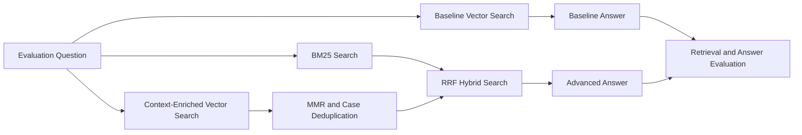

> 과거 수업·제출 실험 기록입니다. 이번 오프라인 재실행 결과나 독립 정답 평가 결과가 아닙니다. 실행 절에는 유료 API 호출이 포함되어 있습니다.

# 저작권 판례 Advanced RAG 실험

## 프로젝트 개요

대법원 저작권 판례를 대상으로 한 Baseline RAG에 Advanced RAG 기법을 단계적으로 적용하고, 공식 Evaluation Set으로 검색 및 답변 품질을 비교한 실험입니다.

완벽한 모델을 만드는 것보다 각 기법을 선택한 이유와 실제 개선·악화 사례를 확인하는 데 초점을 두었습니다.

## 실험 구조

## 적용한 기법

1. Context-Enriched Chunking
   - 판례 본문에 사건명, 사건번호, 선고일자, 법원명을 추가해 임베딩했습니다.
2. MMR 및 사건번호 중복 제거
   - 동일 판례 청크가 Top-3를 반복 점유하는 문제를 줄였습니다.
3. BM25와 Vector Search의 Hybrid Retrieval
   - 의미 유사성과 법률 용어의 정확 일치를 함께 활용하고 RRF로 결합했습니다.

## 평가 방법

공식 12개 문항 중 법률 쟁점이 서로 다른 6개 문항을 선택했습니다.

- E01 폰트·프로그램 저작물
- E03 도급제작·저작인격권
- E05 사진저작물·창작성
- E07 게임·아이디어-표현
- E10 동일성유지권
- E11 인터넷 링크

공식 파일에는 정답 판례와 모범답안이 없으므로 검색 중복률과 고유 판례 수는 코드로 계산하고, Retrieval Relevance·Answer Relevance·Groundedness·Completeness는 동일한 LLM Judge 루브릭으로 비교했습니다. 자동 평가는 보조 지표로 사용하고 판례와 답변 원문도 함께 검토했습니다.

## 주요 결과

| 평가 항목 | Baseline | Advanced |
|---|---:|---:|
| Retrieval Relevance | 3.33 | 4.17 |
| Answer Relevance | 3.83 | 4.17 |
| Groundedness | 4.50 | 4.33 |
| Completeness | 2.83 | 3.50 |
| 평균 고유 판례 수 | 2.0 | 3.0 |
| 평균 중복률 | 33.3% | 0.0% |

네 가지 품질 점수의 평균은 3.62점에서 4.04점으로 상승했습니다. E03, E05, E07, E11은 개선됐고 E10은 변화가 없었습니다. E01은 관련 판례를 놓치면서 악화됐습니다. Groundedness도 0.17점 낮아졌기 때문에 Advanced가 모든 면에서 우수하다고 결론 내리지 않았습니다.

## 핵심 해석

- 검색 결과의 다양성이 증가하면 답변의 완전성이 높아질 수 있습니다.
- 검색 다양성과 특정 정답 판례의 순위는 서로 다른 방향으로 움직일 수 있습니다.
- Hybrid Search는 전문 용어 검색을 항상 개선하지 않으며 가중치와 토큰화의 영향을 받습니다.
- 평균 점수뿐 아니라 질문별 악화 사례를 확인해야 합니다.

## 실행 방법

Google Colab에서 노트북을 열고 다음 파일을 차례로 업로드합니다.

1. `Copyright_case_law_Supreme.xlsx`
2. `Copyright_RAG_Evaluation.xlsx`

Colab Secrets에 `OPENAI_API_KEY`를 등록한 뒤 전체 셀을 실행합니다. 패키지 설치와 API 호출 때문에 실행 환경과 시점에 따라 결과가 조금 달라질 수 있습니다.

## 한계와 향후 개선

- 평가 문항이 6개라 일반화에 한계가 있습니다.
- LLM Judge는 평가 모델의 편향과 변동성을 가질 수 있습니다.
- E01 실패를 개선하기 위해 법률 용어 사전 기반 토큰화와 Hybrid 가중치 튜닝이 필요합니다.
- 질문 유형별 Retriever Routing과 검색 후 Re-ranking을 추가 실험할 수 있습니다.
- 법률 자문 시스템이 아니라 제공된 판례 데이터 범위에서 수행한 RAG 실험입니다.
